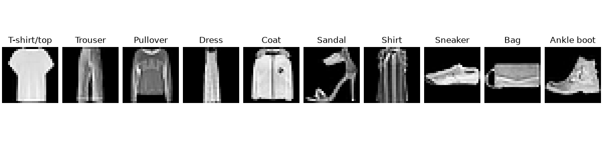

# FashionMNIST Image Classification

A computer vision project to classify images of clothing items using the FashionMNIST dataset. The dataset consists of
grayscale images of ten different classes each of size (28 X 28).

## Class Labels

| Label | Description |
| :--- | :--- |
| **0** | T-shirt/top |
| **1** | Trouser |
| **2** | Pullover |
| **3** | Dress |
| **4** | Coat |
| **5** | Sandal |
| **6** | Shirt |
| **7** | Sneaker |
| **8** | Bag |
| **9** | Ankle boot |

Here are the images:



---

## Model Architectures & Results

| Model Architecture | Parameters | Validation Loss | Validation Accuracy |
| :--- | :--- | :--- | :--- |
| Baseline (Linear) | ~7.9K | 0.4961 | 83.42% |

---

## Project Structure

```text
|-- models/               # Neural network architecture definitions
|-- notebooks/            # Exploratory analysis & experiments
|-- src/
|   |-- train.py          # Training pipeline
|   |-- utils.py          # Data loaders and helper functions
|
|-- README.md
```